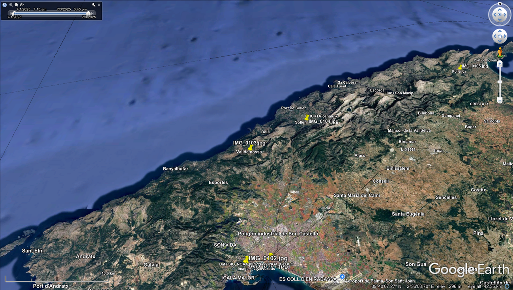
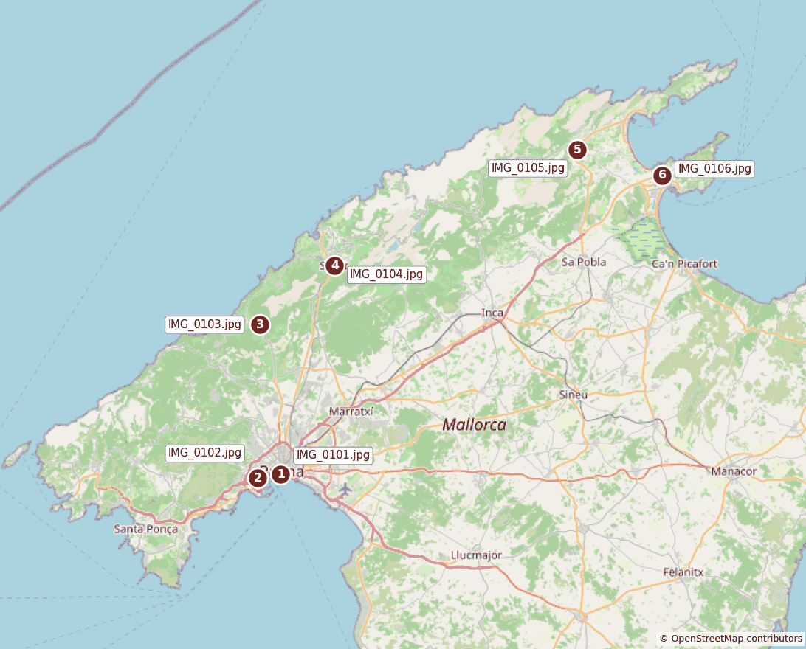

# Picture2kml

Turn a folder of geotagged pictures into a map. Picture2kml reads the GPS
coordinates stored in each picture's EXIF data and creates a KML file with one
placemark per picture, which you can open in Google Earth, Google My Maps, QGIS
and similar tools.



*A KML created from sample pictures, open in Google Earth Pro, with five of its
six placemarks in view. The capture times activate the time slider at the top
left.*

Each placemark has the file name, the coordinates, and, when the picture records
them, the altitude and capture time. Placemarks are in chronological order.

## Installation

Requires Python 3.9 or newer.

```bash
git clone https://github.com/rpicos-uib/Picture2kml.git
cd Picture2kml
pip install -r requirements.txt
```

This installs Pillow, which handles JPEG, PNG, TIFF and WebP. It also installs
`pillow-heif`, which is only needed for iPhone HEIC/HEIF pictures: without it the
script still runs and reports those files as skipped.

## How to use it

### 1. Check that your pictures have a location

Pictures only contain GPS data if location tagging was on when they were taken,
which on a phone is usually the camera app's location setting. Some apps and
messaging services remove this data, so use the original files where possible.

### 2. Run the script on the folder

```bash
python picture2kml.py ~/Pictures/mallorca-trip -t "Mallorca trip"
```

It tells you how many pictures it could place on the map, and where it wrote the
KML file:

```
7 pictures: 6 geotagged, 1 without GPS data, 0 unreadable
wrote /home/you/Pictures/mallorca-trip/photos.kml
```

### 3. Open the KML file

- **Google Earth Pro:** use *File > Open* and select `photos.kml`.
- **Google My Maps:** create a new map, then choose *Import* on a layer.
- **QGIS:** use *Layer > Add Layer > Add Vector Layer*.

The same trip, numbered in the order the pictures were taken:



*Map drawn from the generated KML. Numbers added to show the order. Map data ©
[OpenStreetMap contributors](https://www.openstreetmap.org/copyright).*

## Options

| Option | Meaning |
| --- | --- |
| `-o`, `--output FILE` | KML file to write (default: `photos.kml` inside the directory) |
| `-r`, `--recursive` | Also search subdirectories |
| `-t`, `--title TEXT` | Document title (default: the directory name) |

For example, to process a folder and all its subfolders and write the result
somewhere else:

```bash
python picture2kml.py ~/Pictures/2025 --recursive --output ~/maps/2025.kml
```

The exit status is 0 on success, 1 if no geotagged pictures were found (no file
is written), and 2 if the directory does not exist.

## What the KML contains

Each picture becomes a placemark like this one:

```xml
<Placemark>
  <name>IMG_0101.jpg</name>
  <description>Taken: 2025-07-01T09:15:00+02:00&lt;br/&gt;Altitude: 12.0 m&lt;br/&gt;File: IMG_0101.jpg</description>
  <TimeStamp>
    <when>2025-07-01T09:15:00+02:00</when>
  </TimeStamp>
  <Point>
    <coordinates>2.6483000,39.5675000,12.0</coordinates>
  </Point>
</Placemark>
```

Pictures are skipped rather than placed on the map if their GPS tags are unusable:
no hemisphere reference, out-of-range values, or `0,0`, which cameras commonly
write when they have no satellite fix.

## Privacy

A KML file made from your pictures reveals where you were and when. The included
`.gitignore` keeps `*.kml` files and pictures out of version control. The images
in this README come from generated sample files, not real photos.

## Tests

```bash
python -m unittest
```

## License

[Apache License 2.0](LICENSE). If you redistribute this software or a work based
on it, you must keep the attribution in [NOTICE](NOTICE).

If you use it in academic or published work, please cite it using
[CITATION.cff](CITATION.cff), or the "Cite this repository" button on GitHub.
